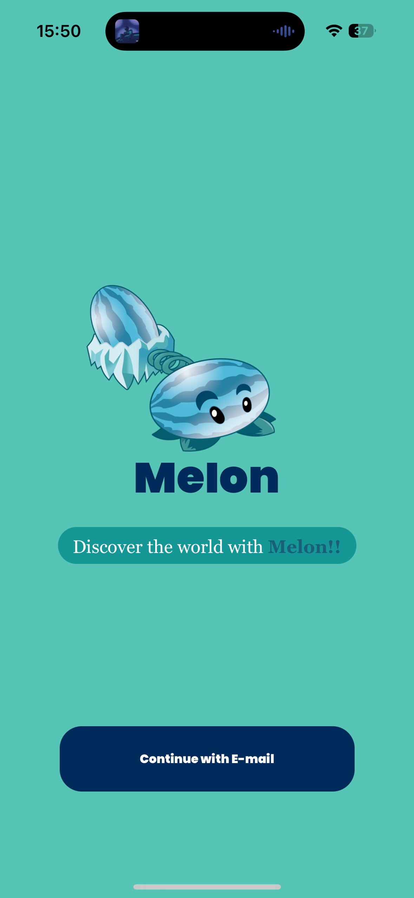
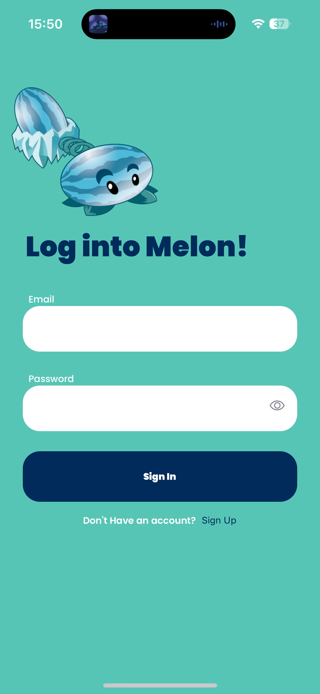
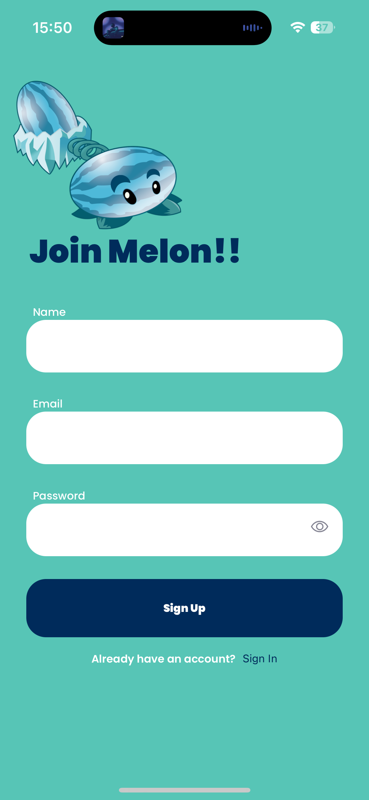
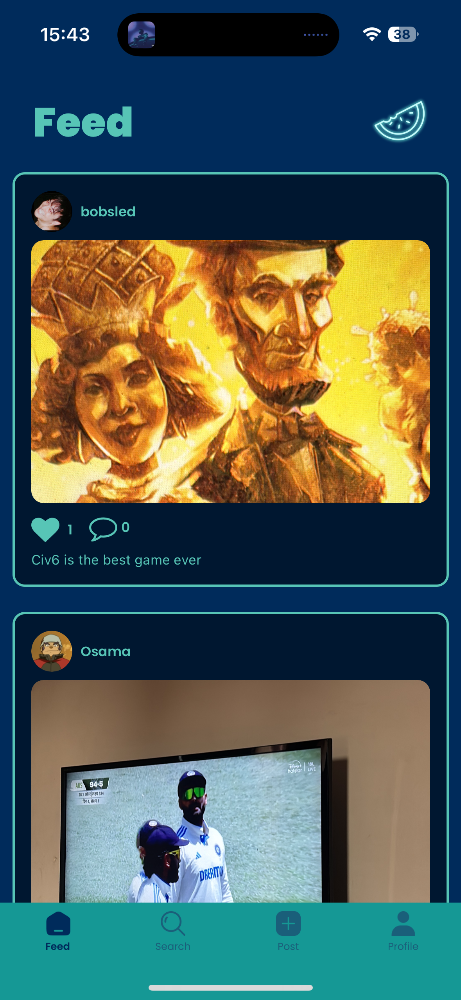
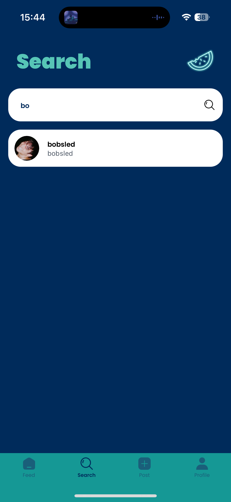
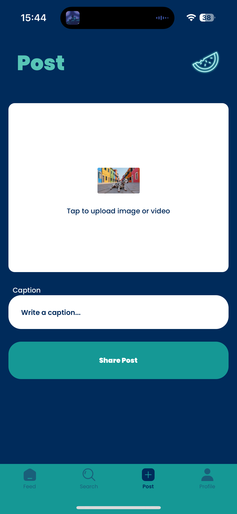
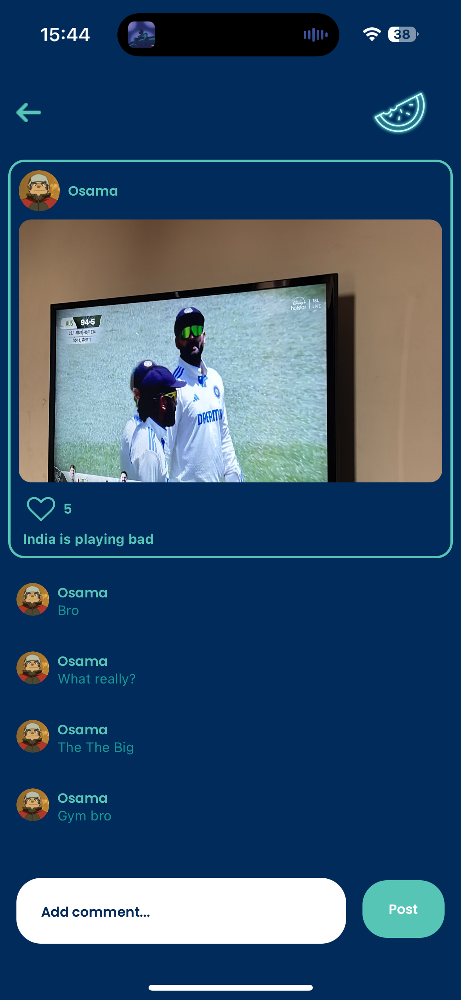
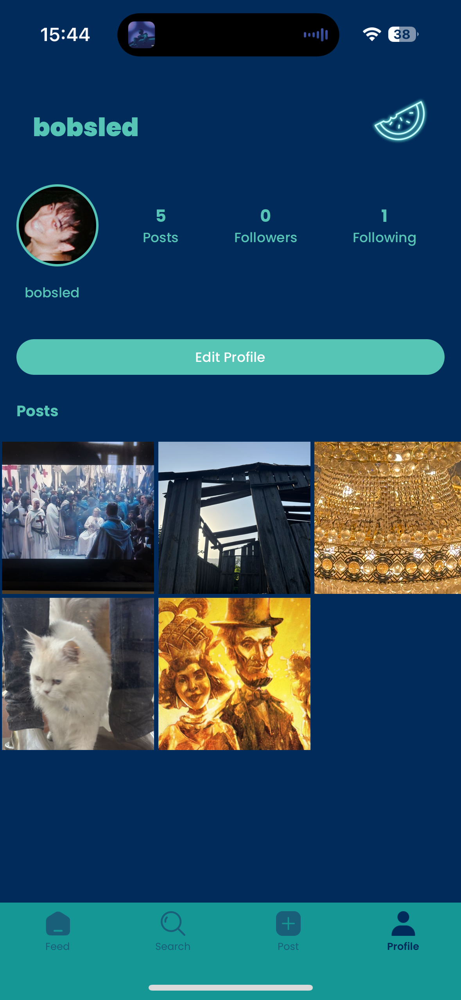

# Melon - Social Media Application

A full-stack social media app built from scratch with React Native (Frontend), Node.js (Backend), and MongoDB. Kind of Inspired by Instagram however it's not a clone, my app Development Journey started with this project.

## Features

- User Authentication & Authorization
- Profile Management with Avatar Support
- Media Sharing (Images & Videos)
- Post Interactions (Likes, Comments, etc.)
- User Following System
- Feed Management
- Secure Password Handling
- Real-time Updates

## Screenshots

<div style="display: flex; flex-wrap: wrap; gap: 10px;">
    
    
    
    
    
    
    
    
</div>

## Tech Stack

### Backend

- Node.js
- Express.js
- MongoDB with Mongoose
- Multer for File Uploads
- JWT Authentication
- Bcrypt for Password Hashing

### Frontend

- Expo
- React Native
- TypeScript
- NativewindCSS
- Context API for State Management

## API Endpoints

### User Routes

- Multiple user routes such as, user registration, login, profile management, etc.

### Media Routes

- Mulitple Media routes such as, uploading media, fetching media, etc.

## Getting Started

1. Clone the repository
2. Install dependencies:

```bash
cd app-backend && npm install
cd app-frontend && npm install
```

3. Start the backend server: npm run dev
4. Start the frontend server: npx expo start
5. Start the mongoDB server
6. Open the app in Expo Go on your mobile device or emulator.
